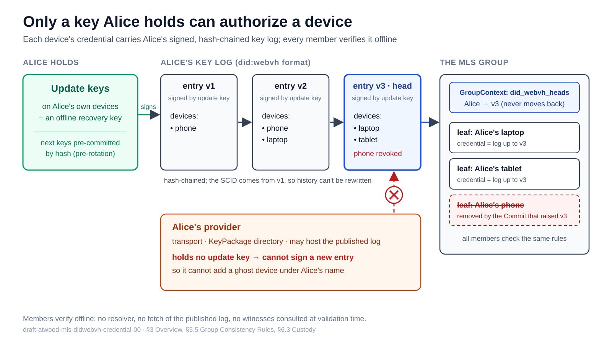

# User-Controlled Device Authorization for MLS

Notes to read alongside my MLS slot at IETF 127 (Friday 20 November 2026)
on [draft-atwood-mls-didwebvh-credential](https://datatracker.ietf.org/doc/draft-atwood-mls-didwebvh-credential/).

Mark Atwood

## In short

In federated MLS, any one provider can add a device under its user's name
to every group that user is in, and nobody else can stop it. This draft
moves the decision about which devices are a user's to keys the user
holds. A provider without those keys cannot add a device at all.

The question I'd most like the WG's view on is the encoding. -00 uses
did:webvh, but nothing in the design depends on DIDs.

## The problem

MLS leaves identity to an Authentication Service.
[RFC 9420 §5.3.1](https://www.rfc-editor.org/rfc/rfc9420#section-5.3.1)
treats a credential as valid when the AS says its identifiers go with the
member's signature key. Both credential types RFC 9420 defines, basic and
x509, leave that call to one authority.

In MIMI, users of several providers share one MLS group, and each provider
is the AS for its own users. A member on provider B accepts Alice's
devices because provider A says they are hers. If provider A is
compromised or compelled, it can bind an attacker's key to Alice's name.
That client joins as one of her devices and reads everything.
[RFC 9750 §8.4.3.1](https://www.rfc-editor.org/rfc/rfc9750#section-8.4.3.1)
calls this a "ghost user".

Federation makes it worse. One provider's capability now reaches the
users of every provider in the room.

## Detection is not prevention

The mitigations RFC 9750 recommends all detect a ghost device; none
prevents one.

| Mitigation | What it gives | What it depends on |
| --- | --- | --- |
| Key transparency | The owner can see a device the provider added. If apps refuse very recent credentials, the owner may see it before it joins. | The owner monitoring |
| Comparing `authentication_secret` out of band | Two users can confirm they share the same group state | Users comparing values for every member |
| Showing membership changes | Users can notice an extra device | Users spotting one more device among many |

Even when key transparency catches a ghost device early, the owner can
only raise the alarm: the provider still decides which devices are the
owner's. Key transparency and this draft fit together. KT detects, this
draft prevents, and KT also covers first contact, which this draft
doesn't.

## How it works

- **A key log the user holds.** The user's devices are listed in a signed,
  hash-chained log. Adding a device means appending an entry signed by an
  update key, which lives on the user's own devices and in offline
  recovery storage. The provider holds none.
- **The credential carries the log.** Each device's LeafNode carries the
  log up to an entry that authorizes that device's key.
- **Verified offline.** Members check the log themselves, with no network
  access, resolver or witness lookups.
- **The group remembers.** A GroupContext extension records the newest
  log entry the group has accepted for each user. It never moves
  backwards.
- **Revocation by Commit.** To revoke a device, one of the user's other
  devices appends an entry dropping its key and commits it. That Commit
  must also remove every leaf the new entry no longer authorizes.

Every member checks the same rules against the same tree and
GroupContext, so all members reach the same decision about every Commit.

## What it doesn't fix

- **First contact.** Whoever controls discovery can hand Bob a different
  identity the first time he looks Alice up. Once Bob has pinned Alice's
  identifier, substitution is detectable.
- **Custody.** If the provider holds the update keys, nothing changes, and
  other members can't tell.
- **Losing every key.** Lost devices are recoverable with the offline
  recovery key. Losing every key, or an attacker using a committed key
  first, isn't recoverable in the protocol: the user starts a new
  identity.
- **New users joining by external Commit.** A device that's already
  authorized can rejoin that way, but a user new to the group has to be
  added by a member.
- **Size and privacy.** A leaf can carry up to 2 MiB of log data, and
  every member sees the user's whole device history.

## If it isn't a DID

-00 uses did:webvh only as an existing, specified format for a
self-certifying, hash-chained log, with no DID resolution and no
Verifiable Credentials. If the WG would rather not depend on DIDs, the
group rules stay; only the log format and the credential encoding change.

| Stays, whatever the encoding | Changes |
| --- | --- |
| A key the user holds authorizes each device | Log entries in I-JSON, signed with `eddsa-jcs-2022` |
| A signed, hash-chained history, verified offline | DID documents, and did:webvh's form of pre-rotation |
| A self-certifying identifier | did:webvh witnesses |
| The group's record and its rules | The normative reference to a Decentralized Identity Foundation spec |

Ways to build it from IETF pieces:

- **CWT/COSE with a SCITT-style history.** The user's key issues a CWT or
  SD-CWT credential for each device
  ([draft-mahy-mls-sd-cwt-credential](https://datatracker.ietf.org/doc/draft-mahy-mls-sd-cwt-credential/)),
  and the history is a chain of COSE-signed statements in the style of
  [RFC 9943](https://www.rfc-editor.org/rfc/rfc9943).
- **A log in TLS presentation language**, native to MLS but new work.
- **An X.509 chain from a key the user holds**, the direction
  [RFC 9750 §6.1](https://www.rfc-editor.org/rfc/rfc9750#section-6.1)
  already points to.
- **Virtual clients plus a credential the user controls.** Virtual clients
  alone don't keep the provider out: a new emulator can join with any
  credential the others accept
  ([draft-ietf-mls-virtual-clients-02 §6.2](https://datatracker.ietf.org/doc/draft-ietf-mls-virtual-clients/)).

I'll follow the WG on this. My own preference is CWT/COSE.

## Questions for the WG

1. **Encoding.** did:webvh, or one of the options above?
2. **Extension or component.** Carried as a component of
   `app_data_dictionary` and updated by AppDataUpdate, the record could be
   updated by external Commits and external senders, which would let new
   users join by external Commit.
3. **The rest of Section 7:** ReInit and branching, revocation without one
   of the user's devices, signature schemes other than Ed25519, the cost
   of GroupContextExtensions, record growth, and identity recovery.

## Common questions

**Isn't this a MIMI problem?** MIMI makes it urgent, but the pieces are
MLS pieces: a credential type and a group extension. Any deployment
where members don't all trust the same AS has the same exposure.

**Why not a user-run X.509 CA?** RFC 9750 §6.1 already suggests device
keys signed by an identity key. This draft makes that a group rule:
revocation must remove the device, members never fetch revocation status
and so can't disagree, and the group's record only moves forward. An
X.509 chain is one possible encoding.

**Can the hub or DS still interfere?** It can delay or drop the Commit
that carries a revocation. It can't forge or alter a credential.

**What do other members learn?** The user's whole device history: how
many devices, and when each was added and removed.

**Is anyone implementing it?** I'm implementing it in
[mimid](https://github.com/MarkAtwood/mimid), my MIMI implementation,
over OpenMLS.

## Since -00

The source for -01 already corrects two things and adds one, in
[the draft's repository](https://github.com/MarkAtwood/mls-didwebvh-credential):

- Key transparency: the owner monitors, and other members have work only
  for very recent credentials. Thanks to Brendan McMillion for the
  correction on mls@.
- Virtual clients alone don't give the property.
- A new open question on identity recovery.

Comments to mls@ietf.org, or as issues at
[github.com/MarkAtwood/mls-didwebvh-credential](https://github.com/MarkAtwood/mls-didwebvh-credential).
